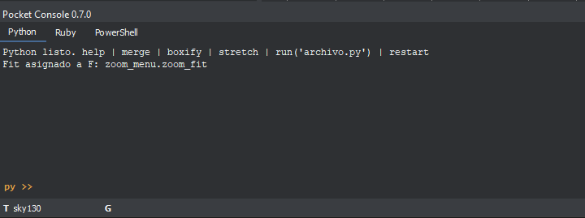
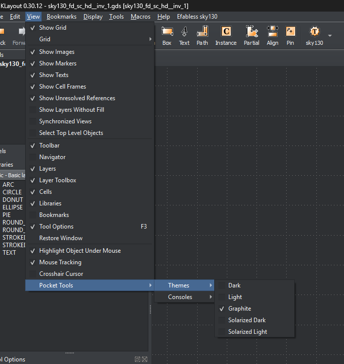
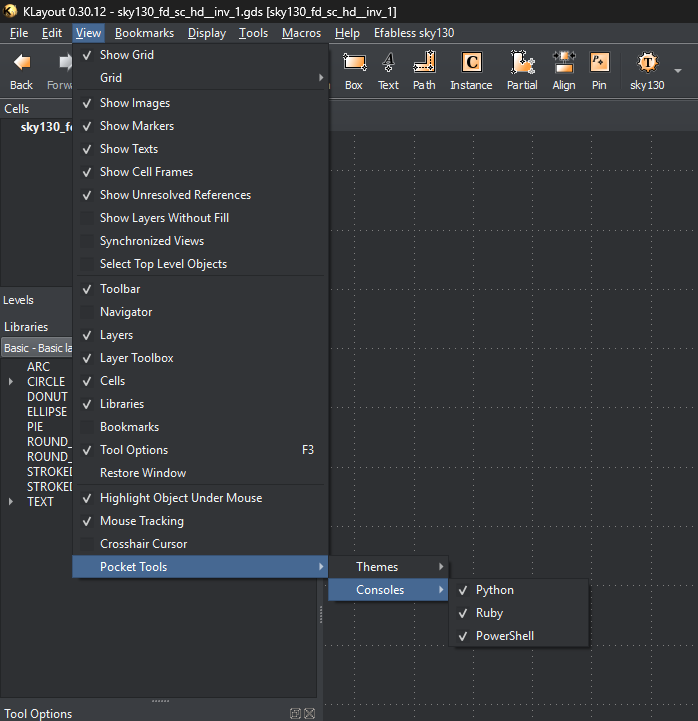
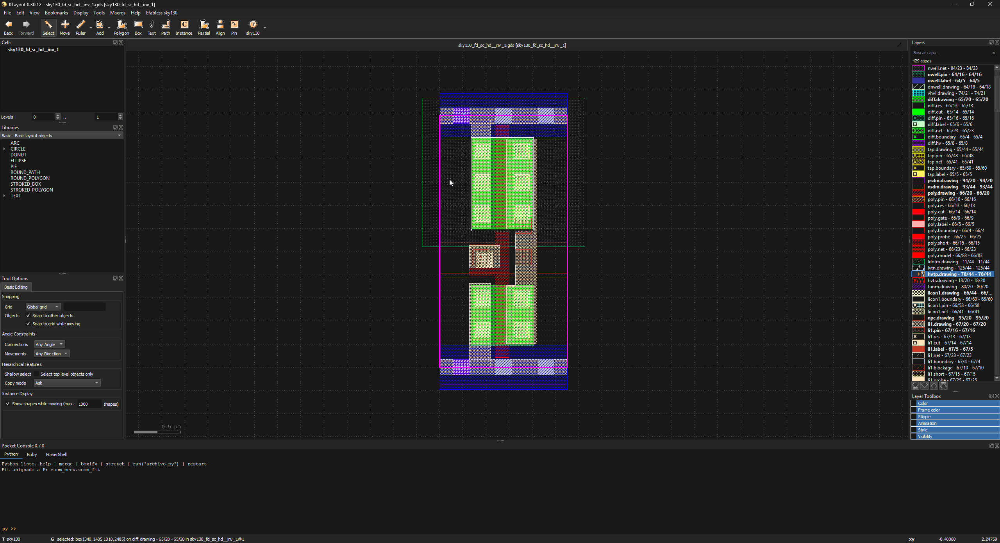
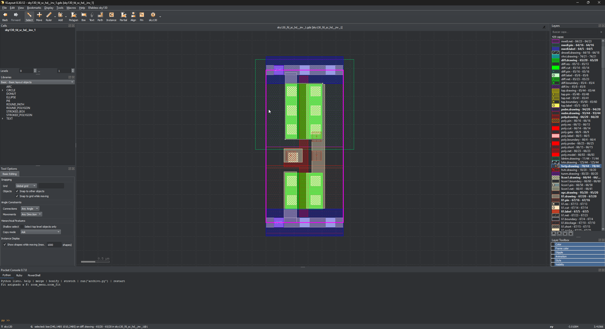
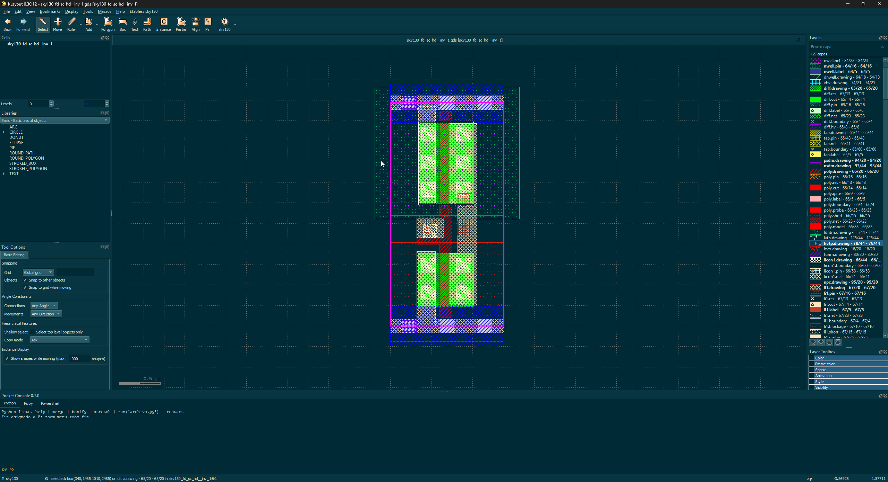
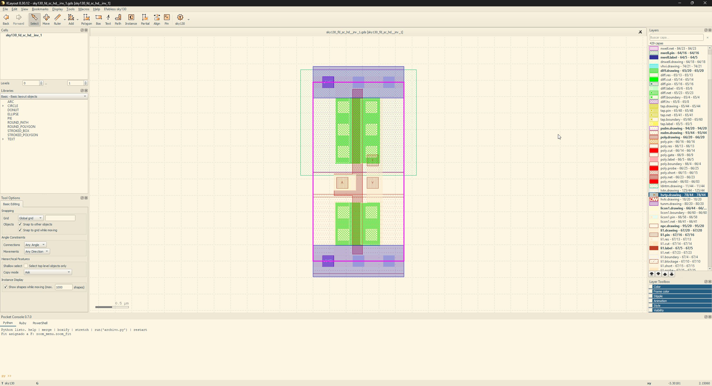
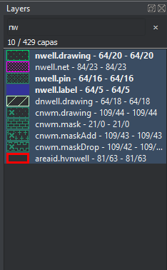

# Pocket Tools 1.0

Themes, consoles, layer search, editing commands and bindkeys for KLayout 0.30.12.

<p align="center">
  
</p>

## Install and get started

**Method 1.** Close KLayout and extract the package into its data directory:
`%USERPROFILE%\KLayout\salt\` on Windows. Open KLayout in editing mode.

**Method 2.** Open **Tools → Manage Packages**, find Pocket Tools and install it. (not available yet)

- **View → Pocket Tools → Themes:** Dark, Light, Graphite, Solarized Dark and
  Solarized Light. The last theme is saved; layer colors are configured separately.
  DRC descriptions use light blue in dark themes for readability; light themes
  retain native blue. The DRC tree keeps native status colors, including green
  for rules with no outstanding errors. Marker and layer colors are unchanged.
- **View → Pocket Tools → Consoles:** show or hide Python, Ruby and
  PowerShell/Bash independently. Python opens first. If you hide every console,
  restore the dock by enabling any console from this menu. Hiding a tab preserves
  its session and history. Windows uses PowerShell; Linux uses Bash.
- **Layer search**, above Layers: filter by name or `68/20`, use `*` and `?`
  wildcards and see the match count. **Esc** or **×** clears the search;
  **/** from the layer list focuses the search bar and **Enter** returns to
  Layers. Filtering does not change visibility in the drawing.

<details>
<summary>Show the theme and console menus</summary>

<p align="center">
  <br>
  <strong>Choose a theme</strong><br>
  View → Pocket Tools → Themes
</p>

<p align="center">
  <br>
  <strong>Show or hide consoles</strong><br>
  View → Pocket Tools → Consoles
</p>

</details>

### Themes

| Dark | Graphite |
| --- | --- |
| [](images/dark_theme.png) | [](images/graphite_theme.png) |
| **Solarized Dark** | **Solarized Light** |
| [](images/solarized_dark_theme.png) | [](images/solarized_light_theme.png) |

The screenshots show the fixed SKY130 inverter GDS linked below;
they neither require nor demonstrate that its PCells are loaded.

### Layer search

Filter by name or layer/datatype using the search bar above Layers.

<p align="center">
  
</p>

## Console and editing

In the Python tab, `help` lists the commands. Enter each command on its own,
outside a pending Python block. Python calls and multiline blocks still work;
`py >>` is the initial prompt and `...` indicates continuation.

**Tab** completes commands: `bo` → `boxify`, `str` → `stretch`, `rev` →
`reverse-difference`. When several choices match, **Tab / Shift+Tab** cycles
through them and the output lists the alternatives. With an empty input, Tab
offers all commands. Completion leaves Python expressions and pending multiline
blocks unchanged.

| Command | Action |
| --- | --- |
| `help` | Show console help. |
| `merge` | Run native Merge on the selection. |
| `boxify` | Convert exactly rectangular polygons into Boxes. |
| `stretch` | Toggle Partial and Move; Partial edits edges or endpoints. |
| `move` | Return to Move to move whole shapes. |
| `union` | Union A ∪ B. |
| `intersect` | Intersection A ∩ B. |
| `difference` | Subtract B from A: A − B. |
| `reverse-difference` | Subtract A from B: B − A. |
| `xor` | Symmetric difference: regions belonging to exactly one shape. |
| `restart` | Ask for confirmation to restart KLayout. |

Python helpers: `fit()` fits the layout in view; `view()` and `cv()` return the
active view and CellView; `run('script.py')` executes a script; `clear()` clears
the output and `project()` returns the console's working directory.

`merge` uses native Merge. `boxify` converts exactly rectangular polygons into
Boxes, preserving layers and properties in a single Undo, and reports converted
and skipped counts. Redundant collinear vertices are accepted; holes, notches,
diagonals, instances and objects outside the editable cell are skipped.
`stretch` activates Partial and focuses the canvas: moving an edge, vertex or
path endpoint **changes its shape**. The console displays a warning while Partial
is active, including when enabled through the native tool. To move whole shapes
again, click the button to return to Move, enter `move` or repeat `stretch`.
Both commands support Tab completion. Numeric displacements are deferred to a
future release.

For Boolean operations, select **A with the first click** and add **B with
Shift + click**. Both must be shapes with area, on the same layer and in the
active editable cell. `union` computes A ∪ B; `intersect`, A ∩ B; `difference`,
A − B; `reverse-difference`, B − A; `xor`, the symmetric difference. They replace
both shapes in a single Undo. Invalid selections or empty results leave the
originals intact. If selection sequence numbers tie, subtraction commands ask
you to select A first and then B with Shift; symmetric operations still work.
Parametric history is deferred to a future release.

```python
fit()
run('my_macro.py')
for i in range(3):
    print(i)

```

**↑/↓** browses history and **Ctrl+L** clears output. `restart` asks for `y/n`
confirmation and respects KLayout's unsaved-changes dialog. The console assigns
**F** to Fit at startup. For the full Lugo bindkey profile, run
`macros/pocket_bindkeys.rb` from the Ruby macro editor: **M** Move, **S** Select,
**K** ruler, **P** polygon, **B** Box, **T** text, **Ctrl+S** path and **Ctrl+D**
clear rulers. The full profile is applied only on request.

## PDK manager — experimental

**Work in progress — experimental use, not recommended at this time.**
The manager is under development and outside this release's recommended workflow.
Its commands remain available in the Python tab:

```text
pdk help
pdk list
pdk status sky130
pdk install sky130
pdk install gf180mcuD --source "C:\My PDKs\gf180mcuD"
pdk remove sky130
pdk restart
```

`pdk help` shows help; `pdk list` lists the catalog; `pdk status <id>` shows
diagnostics; `pdk install <id> [--source <path>]` installs or imports a PDK;
`pdk remove <id>` removes the managed copy; `pdk restart` requests restart
confirmation. Quote paths that contain spaces.

Python calls also work: `pdk("status", "sky130")` and
`pdk("install", "gf180mcuD", source=r"C:\My PDKs\gf180mcuD")`.
**Tab / Shift+Tab** completes PDK commands and IDs. Installation and removal run
in the background; read the final message and restart when prompted.
`pdk status sky130` distinguishes installed technology from registered PCells
and reports detected dependency errors.

## Remaining Windows checks

Automated tests use native KLayout with Qt running without a visible window.
**Mouse gestures** means selecting A with a click and B with Shift + click,
reversing that order, selecting both with a selection rectangle and dragging an
edge or endpoint after `stretch`. Those real gestures still need manual checks;
A/B sequence numbers, geometry, Undo and focus have already been verified by API.

**Windows appearance** means reviewing themes, readability and control sizes at
your usual display scaling, plus showing, hiding and restoring the dock in both
floating and docked positions. These are pending manual checks before tagging,
not confirmed defects. See the [test report](tests/RELEASE_CHECKS.md).

Package and Pocket Console version: **1.0**. The
[Salt.Mine](https://sami.klayout.org/) listing uses the summary in `grain.xml`.
Complete the Windows checks before creating the `v1.0` tag.
[MIT license](LICENSE); PDKs retain their own licenses.
